## operaciones basicas con open cv 
## alumno valeria yaretzi NC 1341 
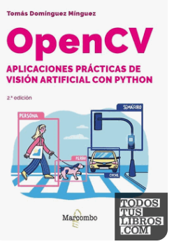
## 1 .lectura de la imagen  desde la carpeta 
##  cuando no se puede cargar la imagen 
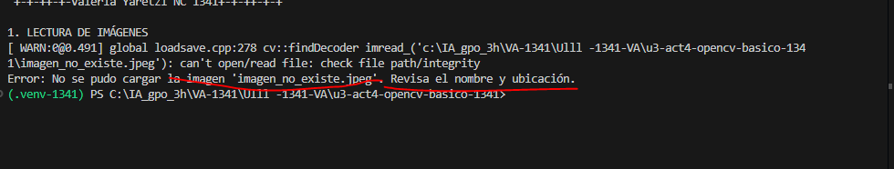
## cuando lee la imagen 
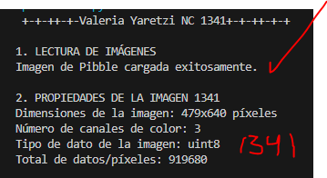
## 2.propiedades de la imagen 
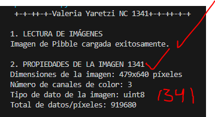

## mostrando imagen original 
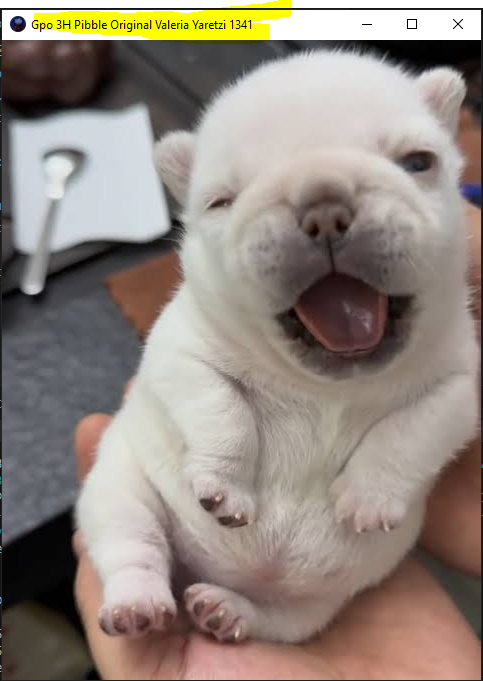
## en la terminal 
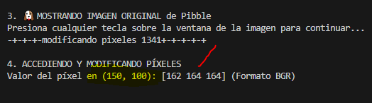
 ## 4. ACCESO Y MODIFICACIÓN DE PÍXELES INDIVIDUALES
 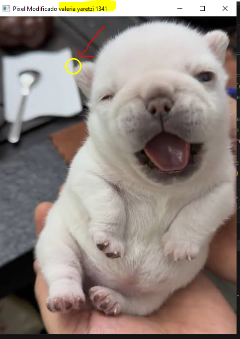
 ## en la terminal 
 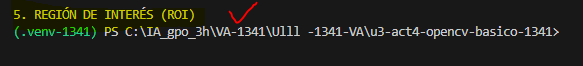
 ## 5. REGIÓN DE INTERÉS (ROI - REGION OF INTEREST)
 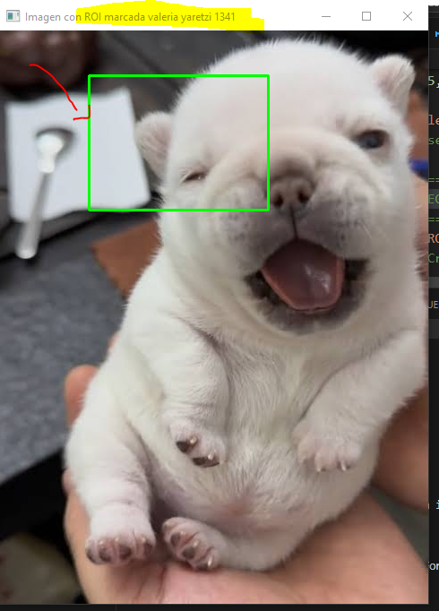
 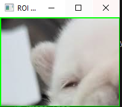
 ## en la terminal 
 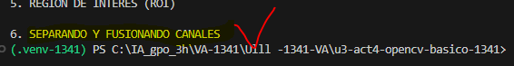
 # 6. SEPARACIÓN Y FUSIÓN DE CANALES DE COLOR (BGR)
 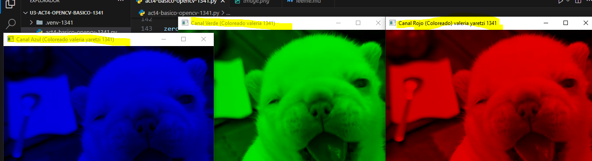
 ## 7. REDIMENSIONAMIENTO DE IMÁGENES (RESIZING)
 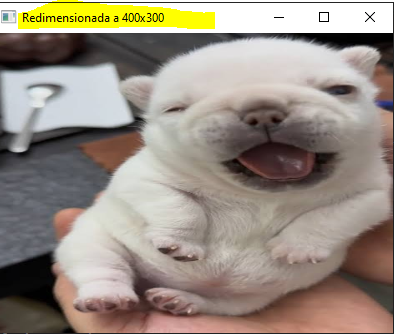
 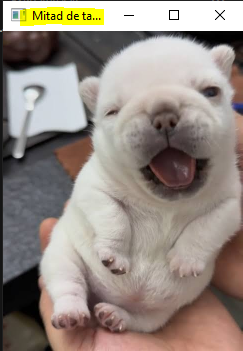
 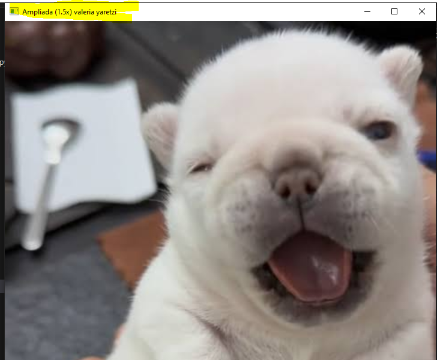
 # 8. ROTACIÓN DE IMÁGENES
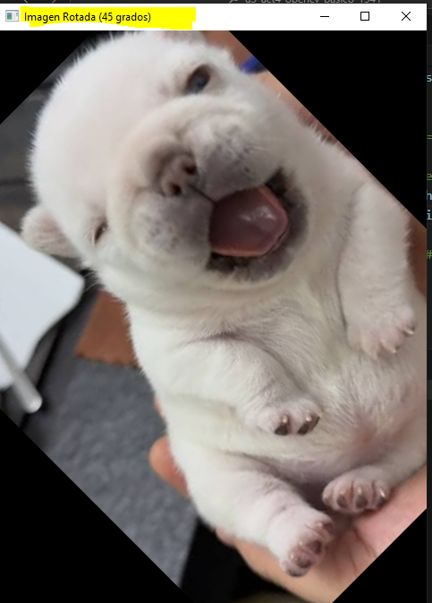
# 9. VOLTEO / ESPEJO DE IMÁGENES (FLIPPING)
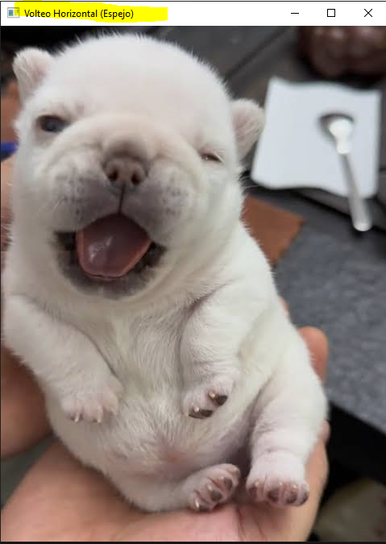
##  10. GUARDADO DE RESULTADOS Y LIMPIEZA
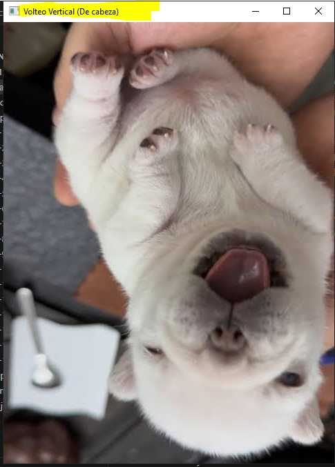
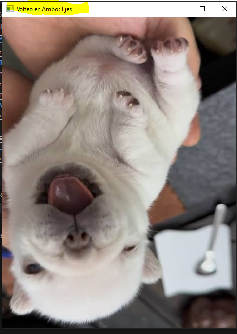
## en la terminal 
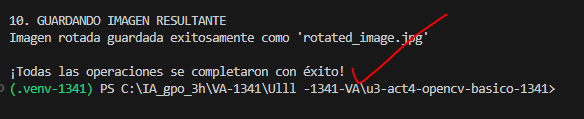